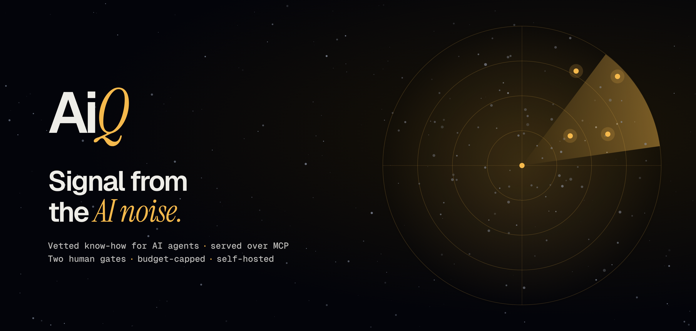
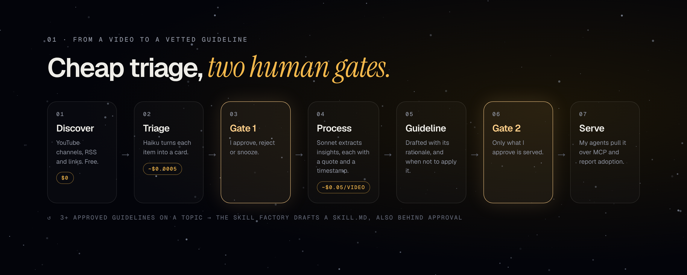
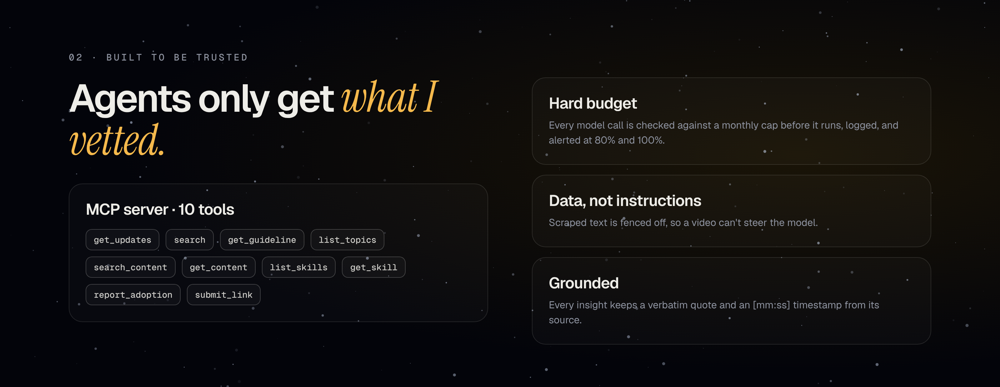

  

> **This is a showcase repository.** The source code is private. This page explains what AiQ does and how it is built.

## What it is

There is far more AI content than anyone can watch, and most of it isn't real or applicable. AiQ is my answer: a vetted knowledge base of know-how for building AI agents.

It follows the creators and feeds I care about, triages everything cheaply, and distills what I approve into grounded guidelines. Only those guidelines are served to my other agents, over MCP.

## From a video to a vetted guideline

1. **Discover.** YouTube channels, RSS feeds and links I send. Free.
2. **Triage.** Haiku turns each item into a short card, for about $0.0005.
3. **Gate 1.** I approve, reject or snooze it.
4. **Process.** Sonnet extracts insights: techniques, tools, prompt patterns, workflows and claims. Each one keeps a verbatim quote and an `[mm:ss]` timestamp, grounded against the source. About $0.05 per video.
5. **Guideline.** Insights merge into draft guidelines, with the rationale and when *not* to apply them.
6. **Gate 2.** Nothing is served until I approve it.
7. **Serve.** My agents pull approved guidelines over MCP and report when they adopt one, which feeds the guideline's evidence.

**Skill Factory.** When three or more approved guidelines share a topic, AiQ drafts a `SKILL.md`. Updates arrive as diffs with version history, and gaps in the topic map become proposals for new skills. All of it waits for approval.

## Built to be trusted

- **Hard budget.** Every model call is checked against a monthly cap before it runs, logged, and alerted at 80% and 100%.
- **Data, not instructions.** Scraped text is fenced off, so a video can't steer the model.
- **Vetted only.** Agents receive only approved guidelines, and must get approval before changing themselves.
- **Per-consumer access.** Each agent has its own token.

## Everyday use

- A daily run discovers and processes new content, then sends me a digest on Telegram.
- A Telegram bot: send it a link to add it, or follow a creator.
- A web panel with approval cards, an inbox, guidelines, a topic map and budget settings.
- A weekly Markdown export.

## At a glance

| | |
| --- | --- |
| **Stack** | Next.js 15 · React 19 · TypeScript · Prisma · Postgres · Docker |
| **AI** | Haiku for triage · Sonnet for insights, guidelines and skills · local Whisper for transcripts |
| **Interface** | MCP server with 10 tools · Telegram bot · web panel |
| **Hosting** | Self-hosted, with a nightly database backup |
| **Status** | Early, running daily |

## About

AiQ is my own project. I'm Igal Taflev, and I put AI to work and keep it accountable. More at [taflev.com](https://taflev.com) and on [LinkedIn](https://www.linkedin.com/in/igal-taflev).

Happy to walk through the pipeline and the MCP setup in a conversation.
